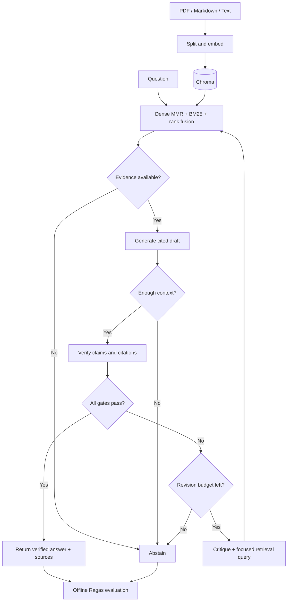

# DocuLens-AI

**Answers you can trace to documents, with a verification loop and measurable quality.**

DocuLens-AI combines advanced retrieval, LangGraph orchestration, and automated Ragas
evaluation in a Python service. It retrieves evidence, generates a cited draft, checks
every claim, and revises or abstains when the evidence is insufficient. The project is
designed as a portfolio repository and a tested foundation for a single-tenant deployment.

## What it demonstrates

- **Advanced RAG:** page-aware PDF/text ingestion, overlapping chunks, persistent Chroma
  embeddings, semantic MMR retrieval, BM25Plus keyword search, reciprocal rank fusion, and a
  bounded context window.
- **Agentic workflows:** typed LangGraph state, separate generator/verifier roles,
  critique-driven query refinement, deterministic citation gates, bounded revisions,
  and explicit abstention.
- **LLM evaluation:** Ragas context recall, answer relevancy, and faithfulness; curated
  gold answers; unanswerable and injection cases; JSONL reports; configurable quality gates.
- **Engineering:** validated settings, dependency injection, async deadlines, API
  admission control, streamed request limits, optional authentication, sanitized errors,
  request IDs, local tests,
  GitHub Actions, and a non-root Docker image.

## Stack

| Layer | Choice |
| --- | --- |
| Language | Python 3.11+; Python 3.12 recommended for local setup |
| Orchestration | LangGraph |
| Retrieval | LangChain Core + ChromaDB + BM25Plus |
| Models | Configurable OpenAI models through LangChain adapters |
| Evaluation | Ragas 0.4 collection-based metrics |
| Interface | FastAPI with interactive OpenAPI documentation |
| Checks | pytest, Ruff, pip dependency validation |

## Architecture



The default permits one initial draft and two revisions. Each retry uses the original
question plus a focused query from the verifier. The graph replaces the prompt context
on each attempt and passes critique feedback to the generator. A deadline bounds the
complete query, including provider retries.

`verified` means the configured verifier and citation gates accepted the answer. It is
not a guarantee of truth. The hallucination risk score is an estimate, not a calibrated
probability; a separate judge model and reviewed benchmarks help expose correlated errors.

## Project structure

```text
DocuLens-AI/
├── src/doculens/
│   ├── agents/
│   │   ├── graph.py          # LangGraph state, nodes, routing, evidence gates
│   │   └── models.py         # Structured generator and verifier adapters
│   ├── pipelines/
│   │   ├── ingestion.py      # PDF/Markdown/text loading and chunking
│   │   ├── index.py          # Chroma persistence and idempotent updates
│   │   └── retrieval.py      # MMR + BM25 + reciprocal rank fusion
│   ├── evaluation/
│   │   └── run.py            # Benchmark execution, Ragas metrics, quality gates
│   ├── api.py                # FastAPI application factory
│   ├── middleware.py         # Query body limit before JSON parsing
│   ├── cli.py                # doculens ingest / ask
│   ├── config.py             # Validated environment configuration
│   ├── schemas.py            # Typed requests, responses, drafts, verdicts
│   └── service.py            # Composition root
├── data/
│   ├── sample_docs/          # Fictional Meridian platform documentation
│   └── evaluation/
│       └── cases.jsonl       # 11 gold cases, kept out of the retrieval corpus
├── tests/                    # Offline graph, API, ingestion, and evaluation tests
├── docs/architecture.md      # Implementation blueprint and extension plan
├── .github/workflows/        # Offline CI + manually triggered paid evaluation
├── app.py                    # Uvicorn entry point
├── .env.example
├── pyproject.toml            # Package metadata and authoritative dependencies
├── requirements.txt         # Editable install with evaluation/dev extras
├── constraints-py312.txt    # Resolved dependency snapshot for Python 3.12
├── Dockerfile
├── LICENSE
└── README.md
```

## Quick start

From the project directory, use a Python 3.11+ interpreter:

```bash
python3.12 -m venv .venv
source .venv/bin/activate
python -m pip install --upgrade pip
python -m pip install -c constraints-py312.txt -r requirements.txt
cp .env.example .env
```

On Windows, activate with `.venv\Scripts\Activate.ps1`. A runtime-only installation
uses `python -m pip install -e .`; evaluation additionally requires
`python -m pip install -e ".[evaluation]"`.
For Python 3.11 or another version, omit `-c constraints-py312.txt` and let pip resolve
the compatible ranges in `pyproject.toml`. The snapshot records Python 3.12 package
versions validated locally on macOS; the Linux CI job also uses it. It is a constraints
snapshot, not a hash-verified universal lock.

The evaluation extra pins Ragas 0.4.3 with LangChain Community 0.4.1 to avoid an
[upstream import incompatibility](https://github.com/vibrantlabsai/ragas/issues/2745)
with Community 0.4.2. Keep these versions together until validating a newer release.

Edit `.env` and set `OPENAI_API_KEY`. The API key remains server-side and is excluded
from Git. Environment variables override values from `.env`. The default model names
are configurable examples; your provider account must have access to the selected models.
Choose a chat model supporting structured JSON outputs.

Ingest only the document corpus, then ask a question:

```bash
doculens ingest data/sample_docs
doculens ask "How long are audit logs retained in standard and enterprise workspaces?"
uvicorn app:app --host 127.0.0.1 --port 8000
```

Open [interactive API documentation](http://127.0.0.1:8000/docs), or query directly:

```bash
curl -X POST http://127.0.0.1:8000/query \
  -H 'Content-Type: application/json' \
  -d '{"question":"Which regions can customers choose for a Meridian workspace?"}'
```

Responses include `answer`, `status`, cited `sources` with chunk IDs and page numbers,
`attempts`, the verifier's claim checks, and per-node timing traces. Returned sources
are cited excerpts, while the evaluator records the full retrieved prompt context.

For your own documents, create `data/private/`, add PDF, Markdown, or UTF-8 text files,
and run `doculens ingest data/private`. Use a dedicated collection for each document root.
Restart the API after ingestion so its BM25 corpus reflects the current index.
Scanned PDFs require OCR before ingestion; the loader reports files without extractable text.
Every input file is parsed and validated before any chunks are written. A malformed
later file therefore cannot leave earlier files partially updated. Embedding or storage
failures can still interrupt writes, so ingestion remains an offline operation.

Keyword retrieval uses BM25Plus with a zero baseline offset. Common query terms retain
positive scores even in a one- or two-chunk corpus, and chunks without matching terms
receive no lexical boost.

## Core pipeline in Python

The graph is built in `src/doculens/agents/graph.py`. Its three primary nodes are
`retrieve`, `generate`, and `verify`; conditional edges lead to another retrieval
attempt, finalization, or abstention. `StateGraph` manages state transitions and trace
accumulation. The evidence gate checks that listed and inline citations agree, every
ID exists in retrieved chunks, and each verified claim points to cited evidence.

```python
import asyncio

from doculens.config import Settings
from doculens.service import build_pipeline


async def main():
    pipeline = build_pipeline(Settings())
    result = await pipeline.run("Who can approve a restore?")
    print(result.answer.model_dump_json(indent=2))


asyncio.run(main())
```

The `Retriever` and `Agents` protocols accept alternative adapters, including local
models, rerankers, and test doubles. The core pipeline has no arbitrary tool execution.

## Automated LLM evaluation

The evaluator runs the same graph used by the API, then scores its actual answers and
the exact chunks seen by the final generator. It does not substitute reference text
for model outputs or mix evidence from previous attempts into the final prompt context.

```bash
doculens-evaluate \
  --dataset data/evaluation/cases.jsonl \
  --output reports/baseline \
  --min-context-recall 0.80 \
  --min-answer-relevancy 0.70 \
  --min-faithfulness 0.85
```

| Metric | What it checks | Required inputs |
| --- | --- | --- |
| Context recall | Reference-answer claims supported by retrieved context | Question, retrieved chunks, gold answer |
| Answer relevancy | Alignment of the response with the question | Question, response, judge LLM, embeddings |
| Faithfulness | Response claims supported by retrieved context | Question, response, retrieved chunks |
| Status accuracy | Expected answer versus expected abstention | Expected and actual status |
| Source recall | Expected source paths found in retrieval | Expected and retrieved source paths |

`results.jsonl` contains per-case outputs, contexts, scores, source recall, attempts,
and traces. `summary.json` contains means, status accuracy, latency, thresholds, dataset
and corpus hashes, prompt hash, model names, and dependency metadata. No sample performance numbers are claimed;
generate them with a real evaluation run.

The process exits with code `1` if a metric mean misses its threshold or any expected
status is wrong. Provider exceptions and invalid numeric scores also fail the run.
Each run reserves a new report directory before creating provider clients. An explicit
`--output` path must not already exist; omitting it creates a unique timestamped path
under `reports/`. Use a new output path when rerunning a benchmark. Failure summaries
contain `passed: false`, `run_status: failed`, and the exception type, while completed
runs use `run_status: completed`. Summary files are replaced atomically, preventing
partial writes or reuse of a previous run's passing summary.
Answerable cases that abstain receive zero answer relevancy and faithfulness, so the
graph cannot improve its benchmark by refusing every question. Unanswerable cases are
judged through status accuracy and excluded from undefined claim metrics.

Each JSONL record follows this format:

```json
{"id":"example","question":"Who can approve restores?","reference":"A workspace administrator must approve a restore.","expected_sources":["access.md"],"expected_status":"verified"}
```

The sample dataset is a wiring and behavior benchmark, not a statistically representative
quality claim. Grow it with real document questions, retrieval failures, ambiguous
queries, and independently reviewed references. Reports contain document excerpts;
keep reports private when evaluating confidential corpora.

LLM-as-a-judge scoring consumes provider tokens and can vary between runs. Normal CI
uses no real API credentials. The **Paid RAG benchmark** workflow runs only when manually
triggered and requires an `OPENAI_API_KEY` repository secret.

## Configuration

| Variable | Default | Purpose |
| --- | --- | --- |
| `OPENAI_API_KEY` | Required for real runs | Model and embedding provider key |
| `DOCULENS_GENERATION_MODEL` | `gpt-4o-mini` | Draft generator |
| `DOCULENS_VERIFIER_MODEL` | `gpt-4o-mini` | Online claim verifier |
| `DOCULENS_EVALUATION_MODEL` | `gpt-4o-mini` | Offline Ragas judge |
| `DOCULENS_EMBEDDING_MODEL` | `text-embedding-3-small` | Document/query embeddings |
| `DOCULENS_PERSIST_DIRECTORY` | `data/chroma` | Local vector store |
| `DOCULENS_COLLECTION_NAME` | `doculens` | Collection namespace |
| `DOCULENS_CHUNK_SIZE` / `DOCULENS_CHUNK_OVERLAP` | `1000` / `150` | Character-based splitting |
| `DOCULENS_TOP_K` / `DOCULENS_CANDIDATE_K` | `5` / `20` | Context count / candidate pool |
| `DOCULENS_MAX_CONTEXT_CHARS` | `16000` | Full-chunk context budget |
| `DOCULENS_MAX_REVISIONS` | `2` | Additional drafts after the initial attempt |
| `DOCULENS_MAX_HALLUCINATION_RISK` | `0.15` | Maximum accepted verifier estimate |
| `DOCULENS_MODEL_TIMEOUT_SECONDS` | `30` | Per-provider timeout |
| `DOCULENS_REQUEST_TIMEOUT_SECONDS` | `120` | Complete graph deadline |
| `DOCULENS_MAX_CONCURRENT_REQUESTS` | `4` | Per-process admission limit |
| `DOCULENS_MAX_REQUEST_BYTES` | `16384` | Maximum streamed `/query` body size before parsing |
| `DOCULENS_API_KEY` | Unset | Optional API authentication |

Set `DOCULENS_API_KEY` before exposing the API externally and include an `X-API-Key`
request header. Keep the default loopback bind for local use. Place public deployments
behind a gateway providing TLS, body-size limits, per-client rate limits, and quotas.
The service independently enforces its query body limit, including chunked uploads and
misleading Content-Length headers; oversized requests receive HTTP 413. Capacity rejection
returns HTTP 429 with `Retry-After: 1`. The current implementation has one shared corpus
and no per-document tenant permissions.

Chroma telemetry is disabled in the client configuration. Ragas tracking is disabled
by default by the evaluation adapter. For optional LangSmith tracing, export
`LANGSMITH_TRACING=true` and `LANGSMITH_API_KEY` in your shell explicitly; tracing can
send questions, chunks, and responses to the configured provider.

## Development and testing

```bash
ruff check .
ruff format --check .
pytest --cov=doculens --cov-report=term-missing
python -m pip check
```

Tests cover successful answers, critique-driven retries, exhausted budgets, no evidence,
invalid citations, unsupported claims, request deadlines, state isolation, API errors,
authentication, capacity limits, real Chroma persistence using local embeddings, stale
chunk removal, index compatibility, ingestion preflight, streamed body limits, small-corpus
keyword matching, stale verifier reports, and evaluation failure handling. They also construct
the current Ragas collection metrics without network calls.

Dependency compatibility ranges are declared in `pyproject.toml`, and
`constraints-py312.txt` records the tested resolution for Python 3.12. Update the
snapshot deliberately after rerunning tests and paid benchmarks. Validate native
package availability on your deployment platform and add distribution hashes when
your release process requires artifact-level locking.

## Docker

```bash
docker build -t doculens-ai .
docker volume create doculens-data
docker run --rm --env-file .env -v doculens-data:/app/data/chroma \
  doculens-ai doculens ingest data/sample_docs
docker run --rm --env-file .env -p 127.0.0.1:8000:8000 \
  -v doculens-data:/app/data/chroma doculens-ai
```

The image runs as a non-root user and uses one worker. Ingest before starting the
server; startup fails clearly if the index is empty or configuration is incompatible.
The image installs runtime dependencies; use a separate evaluation environment for
benchmarking. Docker requires its own local installation.

## Portfolio experiments

Compare dense-only retrieval against hybrid retrieval, and set
`DOCULENS_MAX_REVISIONS=0` to compare one verification attempt with the revision loop.
Measure quality, abstention, attempts, and latency under fixed datasets and models.
Save reviewed evaluation reports and explain failure cases in the repository before
publishing performance claims. Add a demo showing cited answers and a deliberate abstention.

The [implementation blueprint](docs/architecture.md) describes index update limitations,
evaluation semantics, and the path to tenant isolation, versioned indexes, distributed
retrieval, richer parsing, and operational monitoring.

## References

- [LangGraph graph API](https://docs.langchain.com/oss/python/langgraph/quickstart)
- [LangChain Chroma integration](https://reference.langchain.com/python/langchain-chroma/vectorstores/Chroma)
- [Ragas context recall](https://docs.ragas.io/en/stable/concepts/metrics/available_metrics/context_recall/)
- [Ragas answer relevancy](https://docs.ragas.io/en/stable/concepts/metrics/available_metrics/answer_relevance/)
- [Ragas faithfulness](https://docs.ragas.io/en/stable/concepts/metrics/available_metrics/faithfulness/)
- [OpenAI structured outputs](https://developers.openai.com/api/docs/guides/structured-outputs)

## License

MIT. See [LICENSE](LICENSE).
